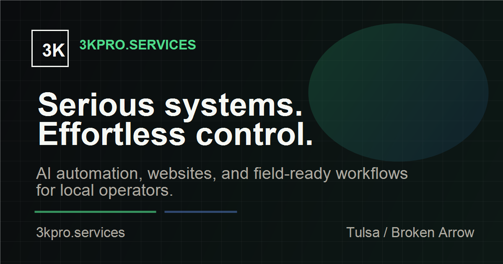

  

<h1 align="center">James Lawson</h1>

<strong>Infrastructure Engineering · Solutions Architecture · Applied AI</strong>

Founder of <a href="https://3kpro.services">3KPRO.Services</a> · Tulsa, Oklahoma area

<a href="https://3kpro.services">Website</a> · <a href="mailto:james@3kpro.services">Contact</a> · <a href="#selected-work">Selected Work</a>

---

I design and build practical software at the intersection of **infrastructure, automation, and business operations**. My background spans 20+ years of enterprise IT, endpoint engineering, and systems support. Today I apply that experience to modern websites, AI-assisted workflows, and tools that are maintainable after the demo.

### Focus

- **Modern websites for real businesses:** Responsive experiences, clear customer journeys, reliable delivery, and straightforward ownership.
- **AI-assisted operations:** Agent workflows, local-model experimentation, developer tools, and human approval for consequential actions.
- **Infrastructure-aware applications:** Integration, automation, operational documentation, and system reliability.

## Selected work

| Project | Engineering focus |
| :--- | :--- |
| **[misfire](https://github.com/3kpro/misfire)** | Zero-dependency Node.js CLI for analyzing AI-agent skill definitions for likely trigger collisions and context-budget issues. Includes automated tests. |
| **[3KPRO.Services website](https://github.com/3kpro/3kpro-website)** | Company website built with Next.js, React, and TypeScript. [Visit the site](https://3kpro.services). |
| **[3K Trading Bot](https://github.com/3kpro/3K_Trading_Bot_V2)** | Python research sandbox for market data, rule-based signals, and a local dashboard. Experimental only; live orders disabled. |

### How I work

`Define the outcome` → `Build the smallest reliable system` → `Test` → `Document` → `Ship`

I favor clear architecture, isolated client workspaces, reproducible checks, and human-controlled production changes. AI can accelerate implementation; verification and accountability still matter.

### Work together

I work with small and midsize businesses on **modern websites and practical automation**, and I'm open to thoughtful engineering collaboration.

**[3kpro.services](https://3kpro.services)** · **[james@3kpro.services](mailto:james@3kpro.services)**
